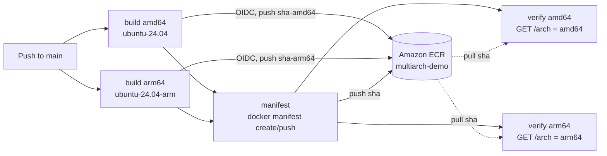

# Multi-Architecture Container Images with GitHub Actions and Amazon ECR

**Author:** Carlos Biagolini-Jr.

**LinkedIn:** https://www.linkedin.com/in/biagolini/

**Medium:** https://medium.com/@biagolini

**Companion article:** https://medium.com/@biagolini/3f9fbf0e2128

> **Didactic notice:** This project was developed as a practical example to accompany a blog post. The architecture decisions made here were chosen to meet an educational objective. They illustrate concepts clearly, not necessarily in the most production-ready way. Feel free to draw inspiration from these ideas, but remember to evaluate the limitations and constraints of your own business before adopting any of them. This project is released under the [MIT License](./LICENSE): you are free to copy, modify, and use it as you wish, but it comes with no warranties and the author takes no responsibility for its use in any environment.

## Overview

A GitHub Actions workflow that builds one container image natively on an x86 runner (`ubuntu-24.04`) and on an ARM runner (`ubuntu-24.04-arm`), pushes both to [Amazon ECR](https://docs.aws.amazon.com/AmazonECR/latest/userguide/what-is-ecr.html), and joins them into a single multi-architecture tag with `docker manifest`, following the [ECR guide for multi-architecture images](https://docs.aws.amazon.com/AmazonECR/latest/userguide/docker-push-multi-architecture-image.html). There is no QEMU emulation and no Kaniko. The workflow authenticates to AWS with [GitHub OIDC](https://docs.github.com/en/actions/how-tos/secure-your-work/security-harden-deployments/oidc-in-aws), so no AWS key is stored in GitHub.

The application is a small HTTP server in Go, using only the standard library, that answers on port `8080` with the CPU architecture it runs on (`amd64` or `arm64`). It is compiled during the image build, so each runner compiles natively for its own CPU, and the resulting image is ready to run on Amazon ECS, Amazon EKS, or any container host.

## Architecture



## Project Structure

```
.
├── .github/workflows/
│   └── multiarch-image.yml   # build matrix, manifest list, verification
├── main.go                   # HTTP server on :8080 with /, /arch, and /health
├── go.mod
├── Dockerfile                # multi-stage: golang build, alpine runtime, non-root user
├── LICENSE
└── README.md
```

## Prerequisites

- AWS account with administrative permission in a lab environment
- A GitHub organization where you can create repositories
- [GitHub CLI](https://cli.github.com/), to read the repository and organization IDs

## Run Locally

```bash
docker build -t multiarch-demo:local .
docker run --rm -p 8080:8080 multiarch-demo:local
curl http://localhost:8080/arch
```

## Build and Deploy

The full console walkthrough is in the companion article. The summary:

1. Fork this repository into your organization, or create an empty repository and push this code to it. In a fork, enable workflows on the **Actions** tab.

2. In IAM, create the OpenID Connect identity provider `https://token.actions.githubusercontent.com` with the audience `sts.amazonaws.com`, if your account does not have it yet.

3. In Amazon ECR, create the private repository `multiarch-demo` with immutable tags.

4. Read the IDs of your repository and organization, and create the IAM role `github-actions-multiarch-demo` with a **Custom trust policy** that trusts only `main` of your repository, plus an inline policy that can push to and read from `multiarch-demo`. The article shows both policies.

```bash
gh api repos/<your-user-or-org>/<your-repo> --jq '{repository_id: .id, owner_id: .owner.id}'
```

5. In your repository, under **Settings** > **Secrets and variables** > **Actions**, create:

| Type | Name | Value |
|---|---|---|
| Secret | `AWS_ROLE_ARN` | ARN of the IAM role |
| Variable | `AWS_REGION` | `us-east-1` |
| Variable | `ECR_REPOSITORY` | `multiarch-demo` |

6. Push a commit to `main`. In the **Actions** tab, confirm that the **manifest** job prints `Platforms: linux/amd64,linux/arm64` and that the two **verify** jobs print `Server reports: amd64` and `Server reports: arm64`.

7. Optionally, run the tag on AWS Fargate with two task definition revisions, one with `Linux/X86_64` and one with `Linux/ARM64`, and open `http://<public-ip>:8080` for each task. Stop the tasks when you finish.

## License

MIT, see [LICENSE](./LICENSE).
